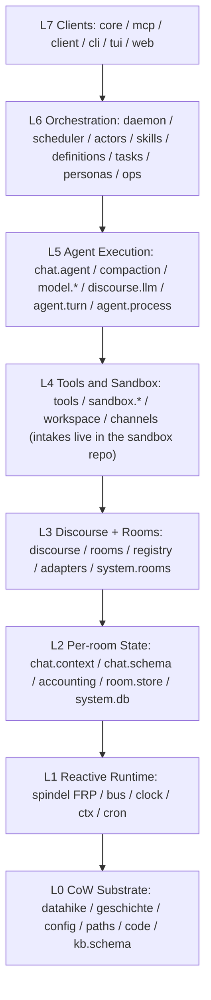
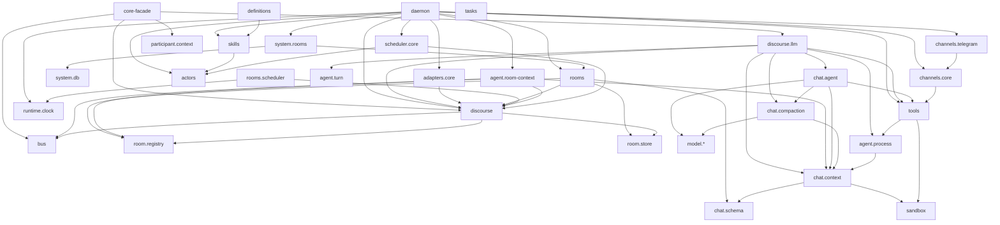
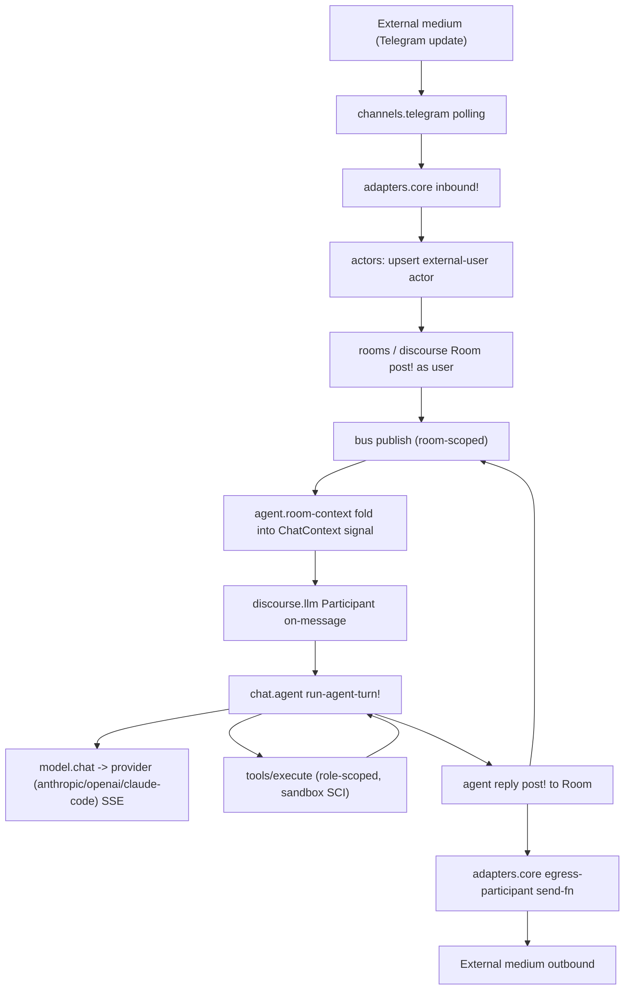

# Dvergr Architecture Map

> A map of the codebase: the layer model, the subsystem dependency graph, the
> inbound message flow, and a per-namespace-family table (the namespaces under
> `src/` + `src-clients/`). The exhaustive per-file table was retired in favour of
> the family table below — it stays accurate across refactors.

## Overview

Dvergr is a Clojure AI-agent harness organized as an 8-layer stack (L0–L7) over a
copy-on-write substrate and a reactive (FRP) runtime. The architecture has
converged on **Rooms + Participants on a Bus** as the single discourse model, with
**medium adapters** (`dvergr.adapters.core`) bridging external chat media (Telegram)
into rooms as remote-user actors. A room is a self-contained project (its own Geschichte
workspace, a git repository kept as a Datahike branch with a muschel virtual
filesystem, + Datahike message/knowledge stores); a thin global **system-db**
(`dvergr.system.db`) is only the registry that keeps the set of rooms/agents together.

Repeated `system.rooms/hydrate-rooms!` on the same daemon root preserves healthy
room contexts and store handles. This keeps registered Room objects and their
message buses aligned during an embedder's sequential transport-only restart;
missing or failed rooms may retry. Switching daemon roots requires explicitly
releasing the predecessor's room stores first. Hydration does not make
concurrent bootstrap calls atomic or replace the daemon shutdown lifecycle.

**Layer summary:**
- **L0 — CoW substrate / persistence**: config loading (`substrate/config`), the
  Geschichte room workspaces (`substrate/geschichte`; forking a room branches
  them), state-root paths (`substrate/paths`), logging
  (`substrate/log`), the katzen-bound knowledge schema (`kb/schema`), exact-text +
  semantic code parsing (`code`), and per-domain Datahike schema (`scheduler/schema`).
- **L1 — reactive runtime primitives**: spindel ExecutionContext/FRP (external), the
  pub/sub `runtime/bus` + `runtime/peer-bus`, the single reactive `runtime/clock`, the
  CoW execution-context memory model (`runtime/ctx`), and the pure cron math
  (`scheduler/cron`).
- **L2 — per-chat / per-room state**: `chat.context` (signals + Datahike + SCI),
  `chat.schema` (the unified Datahike schema), `chat.accounting` (microdollar budgets),
  `participant.context`, the per-[room,agent] folded ChatContext (`agent/room-context`),
  Room store impls (`room/store/*`), the `system.db` registry and the in-memory code
  index.
- **L3 — discourse + rooms**: `discourse` core (Room/Participant/Message, fork/merge,
  algebra: ask/fan-out/race/quorum/pipeline), the `room.registry`, `rooms` (CRUD +
  Datahike unification), rooms-as-projects provisioning (`system.rooms`, `system.mail`),
  reactive room views (`rooms/messages`, `rooms/tree`, `rooms/stats`, `rooms/forks`), the
  per-room reactive scheduler (`rooms/scheduler`), and the transport-agnostic `adapters/core`.
- **L4 — tools + sandbox**: the `tools` registry/executor, the SCI sandbox (`sandbox` +
  `sandbox/ns/*` injectors + `sandbox/workspace` load-root + gated `sandbox/deps`),
  structural/analyzer code-edit utilities, the channels framework, and the room
  workspace's file operations. **The read-only intake data sources are no longer in dvergr's source** —
  they live as agent-editable Clojure in the
  [dvergr-sandbox](https://github.com/replikativ/dvergr-sandbox) stdlib repo, cloned into
  each room's workspace; only `intake/bash` (the muschel shell) and `intake/mail` remain
  in-tree.
- **L5 — agent execution**: the turn loop (`chat/agent`), context compaction, model
  abstraction (`model/*` + provider impls for Anthropic/OpenAI, native Codex
  subscription, and CLI compatibility paths), the
  LLM-backed participant factory (`discourse/llm`), the shared turn mechanics
  (`agent/turn`), the system-prompt assembler (`agent/prompt`), and process
  checkpoint/resume (`agent/process`).
- **L6 — orchestration**: the `daemon` (boot and shutdown, agent lifecycle and
  room joining, the Telegram, MCP and web wiring, the store GC loop), the `scheduler`, actors + transport,
  skills + the unified `definitions` loader, tasks, stats, personas, the
  central `ops` spec, and the Telegram channel.
- **L7 — clients**: the `core` facade, MCP server/json-rpc, the nREPL `client`, the CLI
  entry point, the TUI app, and the web dashboard/API.

**Key cross-cutting threads.** Spindel's ExecutionContext is the spine: the
peer-bus (`[:dvergr/peer-bus]`) and the stats cache (`[:dvergr/stats]`) live as
ctx-local state. Schedules do not: they are `:schedule/*` rows in each room's own
messages store, so they fork and merge with the room (`rooms/scheduler`). Canonical
Spindel world forks over registered Yggdrasil systems underpin the
fork/review/merge lifecycle (`rooms/forks` and the `room_fork`, `room_diff`,
`room_review`, `room_merge` and `room_discard` ops; `hire!` forks for subagents,
and the `spawn_agent`/`propose_change` tools are adapters over it).

The daemon (`orchestration/daemon`, about 1300 lines) holds no turn loop and no
evaluator: turns run in `chat/agent` and `discourse/llm`, Telegram traffic goes
through `adapters/core` (the daemon only builds the adapter's capability map), and
evaluation lives in `agent/evaluation` and `agent/experiment`.

The largest remaining structural debt:

- residual `:status :online` presence assumptions in `skills`/`stats` that pre-date the
  resolved "presence = room membership" model.

## Diagrams

### Layer Stack L0–L7

### Subsystem Dependency Graph

### Inbound Message Flow (medium → model → tools)

## Per-namespace-family layout

| family | layer | role |
|--------|-------|------|
| `substrate/{config,geschichte,git,log,paths,load}` | L0 | EDN config load/cache; Geschichte room workspaces (a Datahike branch + a muschel filesystem); native git helpers (the sandbox stdlib clone, the safe fallback workspace); structured logging; `.dvergr/` state-root resolution; thread-safe runtime `require` |
| `substrate/{datahike,store_ids,kontor_book}` | L0/L2 | the one helper that provisions a dvergr Datahike store and registers it as a forkable system; each file store's logical id kept beside it (`<store>.id`, so a moved home opens its stores); a room's Kontor business book, settled by replay |
| `code` + `code/index` | L0/L2 | Clojure source parse/diff + in-memory katzen ACSet code index |
| `kb/schema` | L0 | Knowledge-base schema (katzen canonical → Datahike idents) |
| `scheduler/{schema,cron,core,tools}` | L0–L6 | persistent-schedule schema; pure cron math; spindel-native scheduler; agent schedule tools |
| `runtime/{bus,peer_bus,clock,ctx}` | L1 | pub/sub substrate; control-plane peer-bus; the single reactive clock; CoW execution-context memory model |
| `chat/{context,schema,persist,accounting,compaction,agent,tool_schema}` | L2/L5 | per-chat signals+Datahike state; the unified schema; one durability policy for message persistence; budgets; compaction; the core turn loop; tool→schema gen |
| `participant/context` | L2 | uniform participant context (LLM/human/hybrid) |
| `agent/room_context` | L2 | per-[room,agent] long-lived ChatContext folded from the room bus |
| `system/{db,home,rooms,mail}` | L2/L3 | the global system-db registry (identity backbone); `home.edn` and moved-vs-copied homes (doc/homes.md); rooms-as-projects provisioning/resolvers; attach a briefkasten mailbox as a ygg system |
| `room/{registry,store,store/datahike,store/memory}` | L2/L3 | slug↔Room registry; PRoomStore protocol + Datahike/in-memory impls |
| `discourse` (core) | L3 | Room/Participant/Message, fork/merge, algebra combinators |
| `discourse/{background,enrichment,human,commands,personas,definitions,attention}` | L3/L6 | background spawner; on-message decorators; human participant; slash-command registry; pre-built personas; the unified skill+agent-identity loader; pure attention decisions |
| `discourse/{llm,generation}` | L4/L5 | LLM participant factory; GenerationHandle bridge |
| `rooms` + `rooms/{forks,messages,tree,stats,theme,scheduler}` | L3 | room CRUD + Datahike unification; fork describe/review/merge/discard; signal-backed transcript/tree/stats views; per-speaker theme; per-room reactive scheduler |
| `rooms/{facts,files,repo,subsystems}` | L3/L6 | one change feed per room (a signal bumped on each durable change); workspace files for outside clients (`room_files`/`room_read`/`room_write`); import a Git repository into a room workspace and export its changes as a patch; the one call that starts every per-room subsystem |
| `adapters/core` | L3 | transport-agnostic medium adapter: inbound posting + egress Participant |
| `tools` + `tools/{structural,llm_call}` | L4 | tool registry/executor (role-scoped); structural edits; one-shot LLM tool |
| `effects`, `authority`, `resource` + `resource/authority` | L4 | the effect boundary between sandbox code and the world (doc/effects.md); the `can?` authorization seam; conserved budgets and spindel's resource authority over the ledger (doc/worlds-and-forks.md) |
| `drive/{core,fs,blobs,integration}` | L4 | the built-in room drive mounted at `/drive`: file nodes, the muschel FS, content-addressed blobs, host wiring |
| `io/{frozen_web,acquisition}`, `search/secondary`, `media/{doc,vision}`, `audio/{stt,record}` | L4 | frozen web for discovery experiments; HTTP acquisition records; fulltext over Datahike's scriptum secondary index; document text and vision; speech-to-text |
| `sandbox` + `sandbox/{deps,workspace,work,extensions}` + `sandbox/ns/*` | L4 | SCI runtime (ctx/eval/limits); gated add-libs; the workspace load-root; room-owned handles for spindel work-admission controllers; the extensions an AgentDef's `:sandbox` set names (`:foerster/inference`); the injected namespaces (`io`/`data`/`datahike`/`agent`/`kb`/`room`/`mail`/`codec`/`dev`/`intake`/`malli`), with `doc` attaching their docstrings |
| `sci/clojure_test` + `sci/impl/clojure_test` | L4 | babashka's clojure.test, vendored and adapted for the SCI sandbox |
| `intake/{bash,jail,mail}` | L4 | the only in-tree intakes — muschel-jailed shell (`jail`: listed programs such as python3 under bubblewrap, over a disk mirror of the worktree) + briefkasten mail (all other data sources live in the dvergr-sandbox stdlib repo) |
| `channels/{core,telegram,telegram_commands,telegram_send}` | L4/L6 | channel framework; Telegram Bot API (polling/old dispatch); `dvergr.ops` slash-command binding; outbound Markdown→HTML rendering + chunking |
| `model/{provider,providers,registry,chat,quirks,gateway,subscription}` + `model/api/{anthropic,openai,claude_code,codex_subscription,codex_auth}` | L5 | provider protocol + registry + metadata; origin-confined credential injection; HTTP/SSE, native Codex subscription, and CLI compatibility transports; provider quirks; the subscription usage meter and governor |
| `agent/{turn,prompt,process,tool_commands,persona,ops,fields}` | L5/L6 | shared turn mechanics; system-prompt assembler; checkpoint/resume process; tool commands; persona resolution; agent-management ops + field spec |
| `agent/{program,run,world,roster,workflow}` | L5/L6 | `hire!` and agent programs; durable Runs; a Run's forked work world; immutable rosters; one task run N times on forks |
| `agent/{evaluation,environment,experiment,experiment/{runner,preflight,select,stats},evaluators,attempt,attempt/governance,grounds,spend,trajectory,conversation,episode}` | L5/L6 | the evaluation path (doc/evaluation-model.md): Attempts, EnvironmentDefs, experiments and their runner, preflight, case selection and statistics, evaluator trust tiers, the writer predicate that keeps certified rows immutable, what an Attempt's result rests on (its grounds), spend, trajectory export, certified conversations |
| `agent/{observation,arenas/renewal}` | L5/L6 | bounded, scoped projections over one agent execution tree; a state-backed renewal-intervention arena |
| `catalog` + `catalog/{wiki,wiki_gen,room,room_run,casepack,casepack_cli,report,workspace}` | L6 | catalog workflows (the wiki family) and room workflows (doc/room-workflows.md): bundles, case packs (and `casepack-cli`, a table of cases into a bundle from the shell), `room-run` (a client of the room path), the report |
| `jobs`, `artifact`, `activity` | L6 | [Jobs with retained cleanup leases](jobs-lifecycle.md); content-addressed portable values; durable observations on room messages |
| `orchestration/{daemon,skills,tasks,stats}` | L6 | the runtime daemon (boot/shutdown, agent lifecycle, channel/MCP/web wiring, GC loop); skill registry; task ledger; stats cache |
| `actors` + `actors/transport` | L6 | durable actor identity table; PActorTransport impls |
| `ops` | L6 | central operations spec — one data map; web/MCP/Telegram surfaces derived (datahike-spec pattern) |
| `security/allowlist` | L6 | Telegram user allowlist access control |
| `core` | L7 | public API facade (re-exports discourse/llm/personas/bus) |
| `mcp/{server,json_rpc,http,surface,repl}` | L7 | TCP/stdio MCP server + JSON-RPC/MCP dispatch; Streamable HTTP; profiles, toolsets and result encoding; the REPL's `dvergr.ops` (doc/mcp.md) |
| `clients/client` | L7 | nREPL client — inspect/interact + fork-task workflow over a daemon |
| `cli/main` + `tui/app` (src-clients) | L7 | CLI entry point; the TUI app (a rich medium adapter onto rooms) |
| `web/{server,guard,dashboard,api,ops,agents,apps}` | L7 | http-kit server and its browser boundary (Host/Origin checks); dashboard (hiccup+HTMX); spec-derived JSON API; web `ops` binding; agent config UI; a room's `app/` served as a static app (doc/web.md) |

### Host repository initialization profiles

`substrate.geschichte/ensure-repository!` and `substrate.geschichte/create-system`
accept an explicit `:repository-profile` keyword plus a trusted host
`:repository-profiles` policy map. `substrate.repository-profile/resolve!`
requires the selected policy's three hooks: `:initialize!`, `:prepare-open!`
and `:abort-create!`. No hooks are read from repository files, serialized into
schema or exposed as agent/RPC options. Nil preserves ordinary initialization;
an unknown explicit profile refuses instead of falling back.

Initialization owns an exclusively fresh scope and receives its pristine
connection instead of ordinary initialization/sandbox import. The host must
join its initialization work. Reopening runs synchronous validation/governance
registration before adapter publication; it must not start asynchronous work.
These substrate APIs themselves do not persist room profile intent or publish
Rooms; the host bootstrap described below owns that separate boundary.

Abort must be idempotent and positively join work before connection release
or deletion. Failed abort retains the exact native resources in an opaque JVM
exception field, not executable ex-data. The host can call
`substrate.geschichte/recover-initialization!` to retry abort/cleanup. Recovery
does not rerun initialization and is idempotent after successful cleanup.
Release/deletion uncertainty refuses blind retries; it requires explicit host
reconciliation. Lifecycle hooks must not call recovery reentrantly. Failed
reopening never deletes a pre-existing repository or removes shared governance.

### Profiled Room bootstrap

The registry persists only a repository's keyword `:system/repository-profile`,
never its executable hooks. `dvergr.system.rooms/hydrate-rooms!` accepts the
trusted host's `:repository-profiles` map. A profiled Room needs exactly one
messages system with exactly its expected room/chat identity. Unrelated agent
ChatContext identities may coexist in that store, but every additional room
marker or an expected chat ID on a different entity is refused. The bootstrap
prepares that system's resource governance first and all profiled repository
adapters next, before registering any mandatory adapter. Missing policy or a
failed preparation withholds the Room; reopening never initializes a missing
profiled repository. Several permission grants to one system are deduplicated
by registry UUID, not by native connection object.

`dvergr.system.room-preparation/with-prepared!` is an internal synchronous host
bootstrap seam, not participant preparation or semantic world state. It records
every acquired lease before preparation, unregisters only its exact adapters,
and releases each acquired lease once on positively safe failure. Unknown
registration, uncertain cleanup dispatch, or started publication retain an
opaque private owner rather than releasing possibly live resources. Ordinary
retry/reset cannot bypass that owner; `dvergr.system.rooms/recover-room-preparation!`
only retries positively safe cleanup. Child contexts do not own an independent
root lifecycle and are not closed as though they did.

`dvergr.system.room-intent/create!` records pending creation intent in ONE control
database transaction: stable Room/system/grant UUIDs, an explicit default
repository, its profile, and owner grants. It refuses existing slugs. It does
not open native stores or make the Room ready. Pending and unsupported-version
intents are refused by ordinary hydration. After the host has completed owned
native preparation, `dvergr.system.room-intent/mark-ready!` guards the transition
against the exact original metadata and grants, before live context publication.
Its exact acknowledgement retry is idempotent. This helper is not yet wired to
ordinary room creation and does not assert cross-store atomicity, native
readiness evidence, automatic creation retry, or legacy migration.

`dvergr.system.rooms/provision-profiled-room!` is the explicit HOST creation
composition. It requires a bound daemon root and a non-engine host thread;
trusted policy hooks are supplied separately from the closed intent options.
After validating policy, it records pending intent, initializes the exclusive
new repository, then acquires and prepares messages/repository/KB adapters in a
private context. Mandatory resource governance precedes publication. Readiness
CAS runs before the context enters the live registry. The returned IDs and
paths have the same shape as ordinary room provisioning, but an existing slug
is deliberately not success or an automatic resume.

Failures retain the original error and any opaque preparation owner under the
already durable Room ID. A changed grant refuses readiness; a lost readiness
acknowledgement may leave durable ready state without a published context. Both
are publication uncertainty, never an excuse to compensate potentially live
resources. Fulltext declarations are deliberately omitted here: asynchronous
index builds require their own explicitly owned lifecycle. This API is not an
authorization endpoint and is not enabled by generic room creation or transport
handlers; an embedder must select the host policy and authorize activation.

`dvergr.rooms/register-prepared-room!` is the separate HOST-only live Room
registration step. It consumes one already-prepared canonical Room context,
checks persisted readiness and messages identity, and never reprovisions or
rewrites control metadata. Exact live incarnations are reused; foreign
incarnations and contexts are refused before construction. Hosts must serialize
this step with root hydration and teardown. Unprofiled marker-free legacy Rooms
may use it only after their ordinary native preparation has completed.

A failed constructor may already have started bus pumps or published its Room.
Its exact context is retained behind the existing preparation recovery gate;
ordinary retries, release and reset cannot discard it. New Run admission closure
is attempted. If that fence itself fails, its error is retained as suppressed
evidence and admission remains explicitly uncertain. This is not a drain or an
automatic constructor retry: explicit host reconciliation is required.

### Adding a granted KB to an existing Room

Hydration is a boot operation, not a live attachment refresh: repeating it
preserves the canonical context and its native adapters. A new metadata grant
alone therefore does not activate a native KB adapter in an already-running
Room. The HOST calls `dvergr.system.rooms/ensure-granted-kb!` with the Room and
registry-system UUIDs after authorizing and recording that grant.

The operation accepts only an existing KB on its canonical `:db` branch, with
current readable permission, unambiguous registry/runtime identity and the
original root-owned Room context. Marked pending, archived, foreign-root and
engine callers refuse. Exact existing adapters are reused without another
connection lease. Adapter type, store identity and branch must match; another
runtime key already holding the physical store refuses. No store creation,
schema installation, fulltext job or replacement of existing adapters occurs.

`dvergr.system.room-preparation/with-addition!` is the internal native ownership
seam. It records acquisition and registration phases, preserves all preexisting
adapters, and releases only its new lease on positively safe failure before
registration. An uncertain acquire, release or started registration retains an
opaque owner behind the existing preparation gate; it is not automatically
retried, unregistered or force-released. Reconciliation of an unknown native
outcome remains an explicit HOST responsibility.

The caller must serialize this HOST operation with hydration and root teardown,
as with prepared Room registration. The creation/attachment monitor alone does
**not** enforce that lifecycle contract. Before exposing this through a live
UI/MCP handler, an embedder must prove that its dispatcher stops admission and
physically joins these calls before native teardown, or provide a shared native
lifecycle coordinator. This foundation does not add a transport endpoint.

Adapter presence is not permission. SCI database handles continue resolving
current grants at use time, including downgrade and revocation. Existing
speculative worlds are not retroactively mounted or replaced by attachment.
