# Job cleanup and Room lifetime

A Job remains a durable Run. The existing process-local `dvergr.jobs/live`
owner retains its callbacks, outcome and waiters until physical cleanup has
been acknowledged. It is not another execution engine or persisted workflow.

The finishing order is:

```mermaid
flowchart LR
    work[Work completes] --> core[before-finish: join work and return resources]
    core --> coreAck[Persist core cleanup acknowledgement]
    coreAck --> persist[Persist terminal Run; retain execution lease]
    persist --> adapter[settled: retire adapter]
    adapter --> adapterAck[Persist adapter cleanup acknowledgement]
    adapterAck --> release[Release execution lease]
    release --> done[Drop Job owner and acknowledge done]
```

Core cleanup, terminal persistence and adapter retirement run under the control
Room's context. `:ctx` still selects the work Spin's execution context, but an
adapter can close that separate context during retirement. Final Run release
therefore uses the surviving control context. No Room access follows release;
the remaining actions only drop process-local ownership and deliver `done`.

`run/retain-finished!` persists the chosen outcome without removing its active
execution lease. Room teardown must still wait for that Run. Only
`run/release-finished!` removes the lease and emits `:run/finished`. A terminal
status is consequently compatible with `jobs/status` reporting
`:settled? false` while adapter retirement is pending.

The two acknowledgements are typed UUID attributes on that same Run:
`:run/job-core-cleanup-ack` and `:run/job-adapter-cleanup-ack`. Their identities
are bound to the Job and a versioned native stage. They can only be added after
admission, cannot change or disappear, and the adapter acknowledgement requires
the core acknowledgement and a terminal outcome. They are evidence, not
capabilities. They certify the configured HOST cleanup boundaries; they do not
certify arbitrary descendant work, acceptance, or external effects.

## Failure and recovery

A failed stage stays with the same Job owner. It retains the original error
privately, exposes a bounded stage keyword through `:cleanup-stage`, and reports
`:cleanup-required? true`. Before core cleanup succeeds, the Run may still have
its running/cancelling projection. After terminal persistence, a later cleanup
failure preserves that immutable outcome. It never rewrites a completed Run
into a failed one.

The HOST-only `recovery-state` returns the exact held stage and a fresh token.
After reconciling the original native operation, the HOST calls `recover!` with
that locator and either:

- `:retry`, after establishing that repeating the failed stage is safe;
- `:acknowledge`, attesting the physical outcome without repeating its callback.

Acknowledgement cannot invent terminal persistence or bypass a live execution
lease. Acknowledged stages never repeat. Recovery is exclusive with the monitor
and other recovery attempts; a subsequent failure invalidates the previous
token. These tokens coordinate one native owner; they confer no permission and
are not exposed through SCI or registered as tools. There is no automatic
cleanup replay or timer.

Successful callbacks advance to separate `:core-ack` and `:adapter-ack` stages.
Failure to persist an acknowledgement holds that stage, so retry cannot repeat
its successful callback. A committed write with a lost reply is confirmed using
the same evidence identity and repairs the live Run projection before later
lifecycle writes. HOST acknowledgement at these stages requires the exact
durable witness; it cannot skip a missing write.

Synchronous work-construction failure uses the same lifecycle. Once the Job's
work callback has begun, its adapter retirement belongs to Jobs even if another
admission journal failed to publish its Job pointer. Callers must not also run
an abandonment callback for that same owner.

These native callback handles are process-local. Restart recovery uses the
existing orphan Run/accounting machinery; it does not restore arbitrary native
closures. `jobs/observe-settlement` accepts an explicit Room and reports outcome,
core and adapter witnesses, the native lease, and live-owner presence separately.
Settlement requires both valid witnesses, a terminal outcome, and no remaining
native lease or Job owner. Missing process state alone never proves settlement;
a terminal historical row without witnesses stays unknown/unsettled. A crash
after a callback returns but before its acknowledgement persists remains unknown.
Durable evidence roots and their retained source bindings require their own
journal and retirement policy.

Tests cover real Room-close refusal while core or adapter cleanup is held,
explicit recovery, context retirement, lost terminal/release acknowledgements,
concurrent/stale recovery and synchronous construction failure. Work and all
native fixtures are deterministic and perform no inference.
